<div align="center">

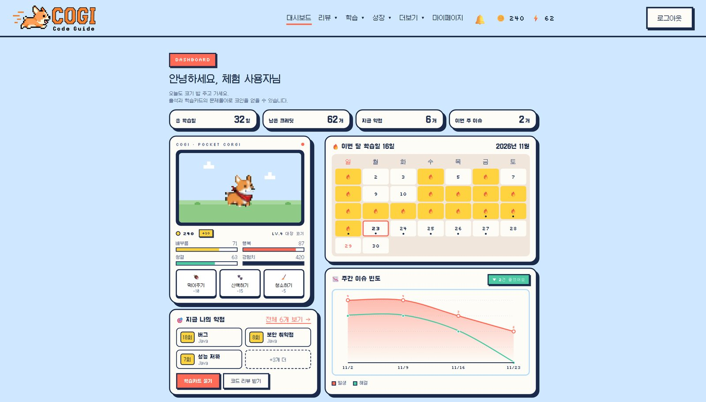

# COGI (Code Guide)

AI가 GitHub Pull Request를 리뷰하고, 발견한 약점을 학습 카드와 주간 성장 리포트로 이어 주는 성장형 코드 리뷰 플랫폼

[](#기술-스택)
[](#기술-스택)
[](#기술-스택)
[](#기술-스택)
[](#기술-스택)
[](#기술-스택)
[](#기술-스택)
[](#기술-스택)
[](#기술-스택)
[](#기술-스택)

[서비스 열기](https://cogi.n-e.kr)  |  [저장소](https://github.com/Leeuswa/COGI)  |  로그인 화면의 「유저 테스트 로그인」 으로 가입 없이 둘러볼 수 있다

</div>

---

## 목차

- [프로젝트 개요](#프로젝트-개요)
- [화면](#화면)
- [핵심 기능](#핵심-기능)
- [아키텍처](#아키텍처)
- [리뷰에서 학습까지의 흐름](#리뷰에서-학습까지의-흐름)
- [ERD](#erd)
- [팀과 담당 작업](#팀과-담당-작업)
- [AI 활용](#ai-활용)
- [트러블슈팅](#트러블슈팅)
- [보안](#보안)
- [기술 스택](#기술-스택)
- [로컬 실행](#로컬-실행)
- [폴더 구조](#폴더-구조)

## 프로젝트 개요

주니어 개발자는 코드 리뷰를 받을 기회가 적고, 받더라도 한 번 보고 마는 피드백에 그쳐 실력으로 이어지지 않는다. COGI는 리뷰, 약점 분석, 학습, 재점검을 하나의 루프로 자동화한다. GitHub PR, 코드 붙여 넣기, 파일 업로드로 들어온 코드를 여러 LLM으로 리뷰해 이슈를 심각도와 카테고리로 정리하고, 그 결과를 개인 약점 통계, 학습 카드와 퀴즈, 주간 리포트로 연결해 리뷰가 성장 기록으로 남게 했다.

| 항⁠목 | 내용 |
|---|---|
| 팀 | Team Fable (4인), 대우능력개발원 KDT 팀 프로젝트 |
| 기⁠간 | 2026.07~08 |
| 서⁠비⁠스 | https://cogi.n-e.kr |

## 화면

| A⁠I⁠ ⁠코⁠드⁠ ⁠리⁠뷰⁠ ⁠결⁠과 | 내 약점 통계 |
|---|---|
| 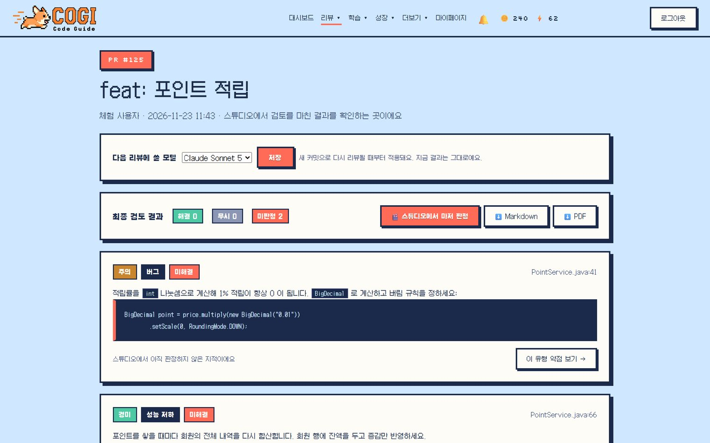 | 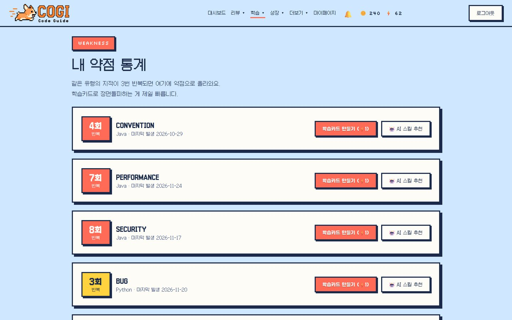 |
| PR을 가져오거나 코드를 붙여 넣으면 AI가 종류, 심각도, 파일 위치와 함께 지적 | 같은 종류의 지적이 3번 이상 반복되면 약점으로 올라옴 |
| **학습 카드** | **퀴즈와 복습** |
| 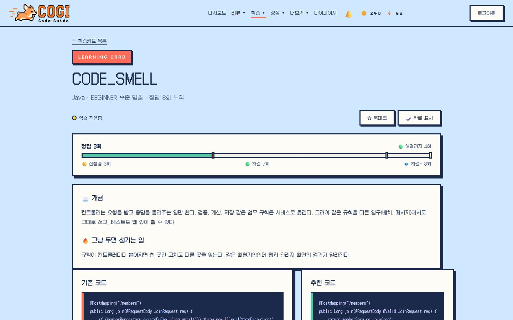 | 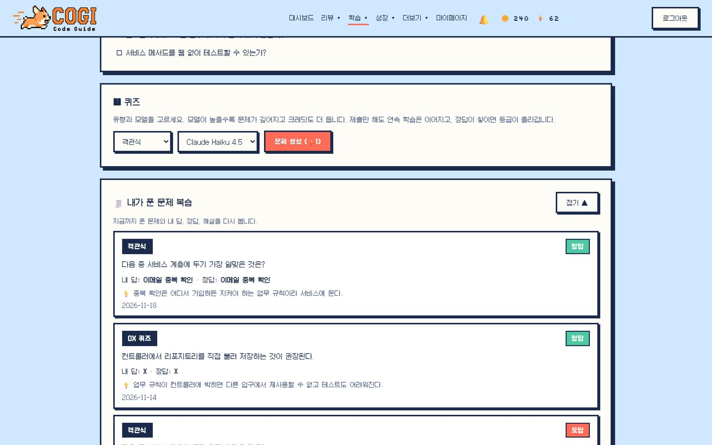 |
| 약점마다 개념, 그냥 두면 생기는 일, 기존 코드와 추천 코드 | 객관식, OX, 단답, 빈칸 퀴즈를 풀고 맞힌 수에 따라 단계가 오름 |

<details>
<summary>리뷰 미리보기 편집과 휴대폰 화면 보기</summary>

<br>

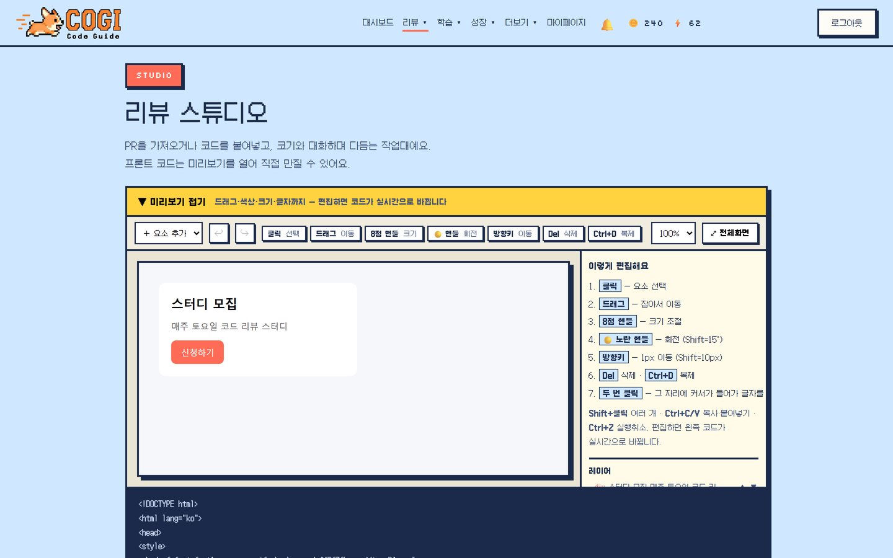

리뷰 스튜디오에서 프런트 코드를 미리보기로 열고, 요소를 눌러 고르고 끌어 옮기면 왼쪽 코드가 바로 바뀐다.

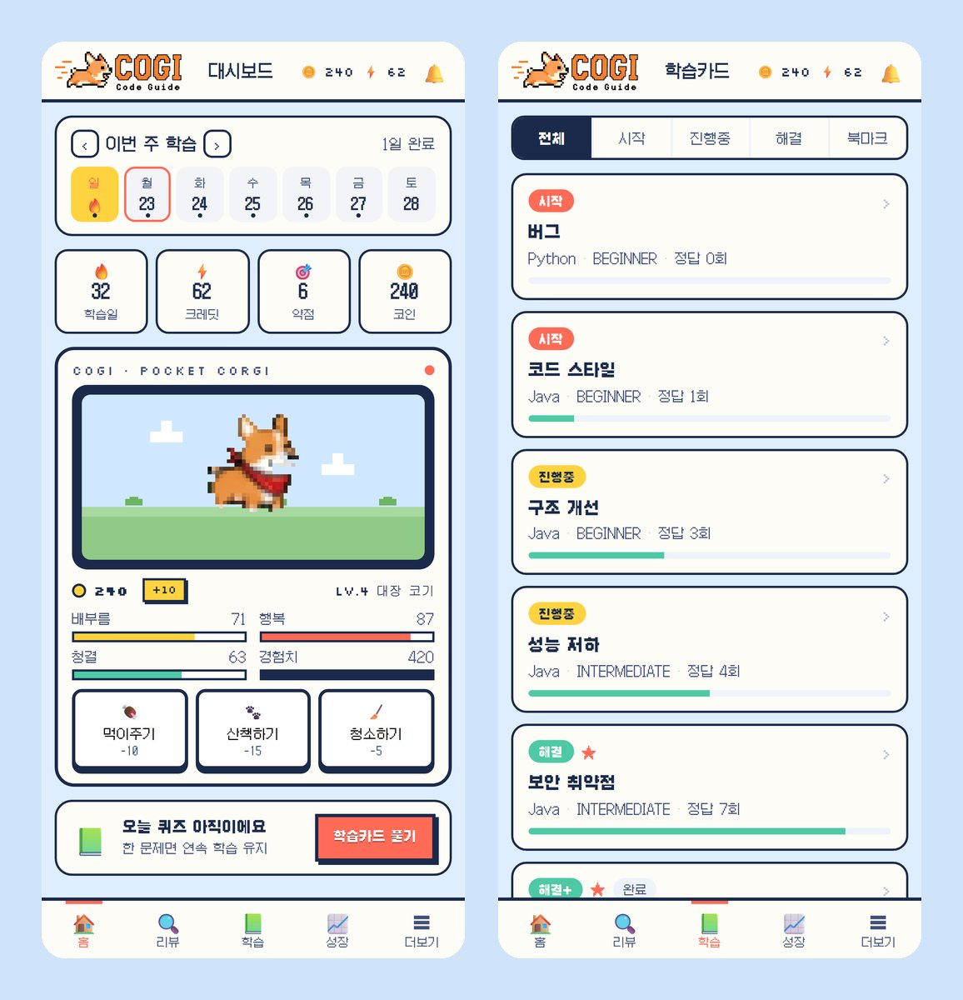

폭 640px 이하에서는 휴대폰 전용 화면이 열린다.

</details>

## 핵심 기능

| 영⁠역 | 기능 |
|---|---|
| A⁠I⁠ ⁠코⁠드⁠ ⁠리⁠뷰 | Claude, GPT, Gemini, Groq를 공통 인터페이스로 묶고 모델 티어와 폴백 적용. `javaparser` 정적 파싱으로 리뷰 정확도 보강 |
| 리⁠뷰⁠ ⁠입⁠력 | GitHub PR 연동, 코드 붙여 넣기, 파일 업로드, 비로그인 체험 리뷰(24시간 3회) |
| 이⁠슈⁠ ⁠분⁠류⁠와⁠ ⁠판⁠정 | 심각도 3단계(심각, 주의, 경미)와 카테고리 5종(버그, 성능, 코드 냄새, 컨벤션, 보안). 리뷰 스튜디오에서 해결, 무시, 재검증(reverify) 판정, CRITICAL 이슈는 팀장 승인 필요 |
| 리⁠포⁠트⁠ ⁠내⁠보⁠내⁠기 | Markdown, PDF(한글 폰트 임베드) |
| 리⁠뷰⁠ ⁠미⁠리⁠보⁠기⁠ ⁠편⁠집 | 프런트 코드를 미리보기로 열어 눌러서 고르고, 끌어 옮기고, 글자를 고치면 코드가 바뀜 |
| 약⁠점⁠ ⁠통⁠계 | 같은 카테고리 지적이 3번 이상이면 약점으로 묶음 |
| 학⁠습 | 약점마다 AI 학습 카드(신호등 등급 YELLOW, GREEN, GREEN+), 카드별 퀴즈와 제출, AI 학습 계획(3, 5, 7, 14일), AI 기술 추천과 즐겨찾기, 강의 추천 |
| 성⁠장⁠과⁠ ⁠리⁠텐⁠션 | 매주 월요일 배치로 주간 리포트 생성과 이메일 발송(이슈 단위 드릴다운), 주차별 이슈 발생과 해결 추이, 팀장의 팀원 비교, 리텐션 펫 코기(코인, XP, 청결도, 연속 출석), 자정 크레딧 초기화 |
| 인⁠증 | 이메일과 소셜(GitHub, Kakao) 통합 로그인, 이메일 인증, JWT(HttpOnly 쿠키), 2단계 인증(TOTP), 로그인 잠금, 비밀번호 재설정, 회원 탈퇴 |
| 팀⁠과⁠ ⁠G⁠i⁠t⁠H⁠u⁠b⁠ ⁠연⁠동 | GitHub OAuth 연동, 레포 연결, PR 목록과 파일 조회, Webhook(서명 검증, 미지원 이벤트 무시, 재시도), 팀원 초대(GitHub 아이디, 이메일)와 수락, 거절, 권한(OWNER, MEMBER), 팀장 위임, 강제 내보내기 |
| 결⁠제 | 토스페이먼츠 빌링키 자동결제, 플랜 전환(업그레이드, 다운그레이드, 해지, 재개), 크레딧 사용량 |
| 관⁠리⁠자⁠ ⁠콘⁠솔 | AI 사용량과 비용 대시보드(벤더 Admin API 연동), 회원 관리, 전체 공지(긴급, 일반), 리뷰 지침, 약관, FAQ, 1:1 문의 |
| 휴⁠대⁠폰⁠ ⁠화⁠면 | 폭 640px 이하에서 열리는 휴대폰 전용 화면 15개 |

## 아키텍처

React 화면이 Nginx를 거쳐 Spring Boot API를 부르고, Docker Compose로 MariaDB, Redis, Backend, Frontend 네 컨테이너를 AWS EC2에 띄운다. 리뷰 쪽과 학습 쪽 AI 호출은 같은 클라이언트(`AiReviewClient`)를 거친다. 파란 칸이 AI다.

<picture>
  <source media="(prefers-color-scheme: dark)" srcset="docs/images/diagram_arch_dark.svg">
  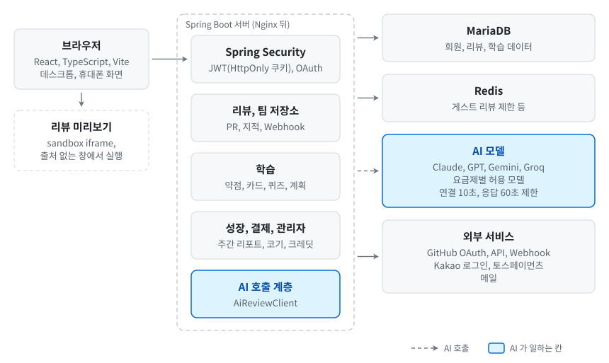
</picture>

| 항⁠목 | 내용 |
|---|---|
| 패⁠키⁠지⁠ ⁠구⁠조 | 도메인별 패키지: `auth`, `user`, `review`, `learning`, `growth`, `repo`, `pr`, `payment`, `admin`, `notification`, `retention`, `terms`, `inquiry`, `webhook`, `guest`, `global` |
| 인⁠증 | 액세스 토큰을 HttpOnly 쿠키로 발급해 XSS 노출을 막고, 소셜 로그인과 이메일 로그인을 하나의 인증 흐름으로 통합 |
| 배⁠포 | Docker Compose로 4개 컨테이너 운영, 환경변수(`.env`)와 설정은 저장소에서 분리 |
| 저⁠장⁠소 | MariaDB 영속 데이터 34개 테이블, Redis는 게스트 리뷰 제한 등 |

## 리뷰에서 학습까지의 흐름

<picture>
  <source media="(prefers-color-scheme: dark)" srcset="docs/images/diagram_flow_dark.svg">
  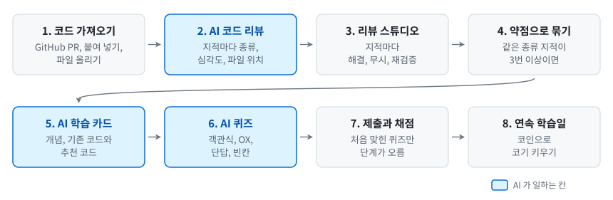
</picture>

약점은 따로 쌓지 않고 조회할 때 리뷰 지적을 종류별로 세어 계산한다. 학습 카드는 초급, 중급, 고급과 모델 등급에 따라 다른 지시문으로 만들고, 같은 퀴즈를 다시 맞혀도 단계는 한 번만 오른다.

## ERD

리뷰와 학습의 핵심 테이블만 추렸다.

리뷰

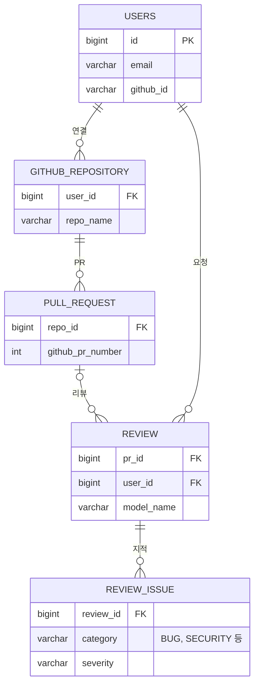

학습

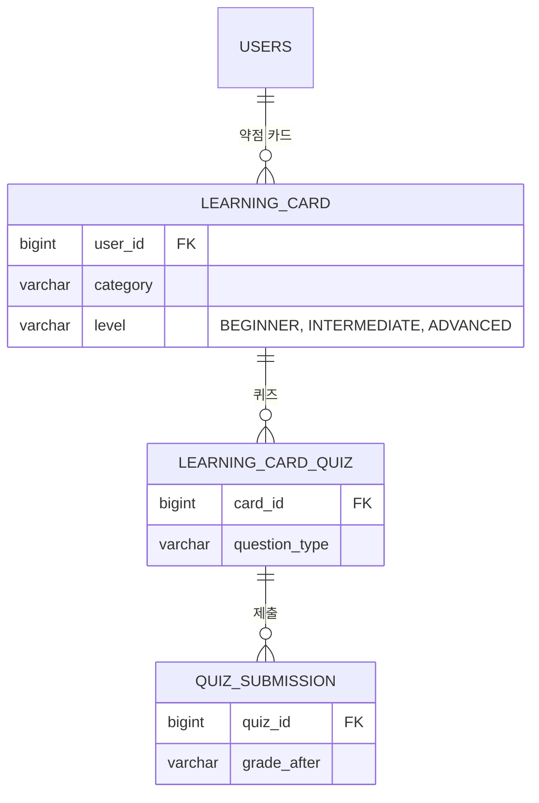

리텐션과 크레딧

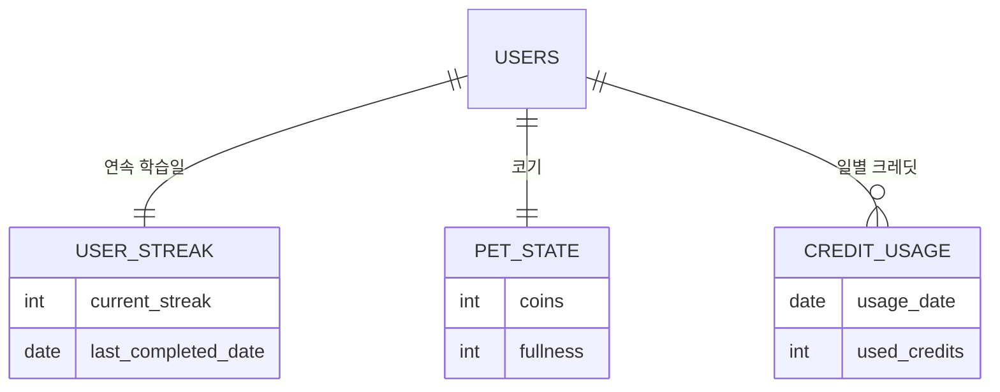

## 팀과 담당 작업

| 팀⁠원⁠(⁠G⁠i⁠t⁠H⁠u⁠b⁠) | 역할 |
|---|---|
| [ynkite](https://github.com/ynkite) | 팀장 |
| [Leeuswa](https://github.com/Leeuswa) | 팀원, 이 저장소 관리 |
| [hongsungchan88](https://github.com/hongsungchan88) | 팀원 |
| [Jihwan0210](https://github.com/Jihwan0210) | 팀원 |

| 담⁠당 | 작업 |
|---|---|
| y⁠n⁠k⁠i⁠t⁠e | 약점 통계 API, 학습 카드와 퀴즈, 학습 계획, 연속 학습일<br>학습 쪽 AI 호출 계층(Claude, GPT, Gemini, Groq)<br>리뷰 화면 미리보기 편집, 휴대폰 전용 화면 15개(팀원이 일부 수정)<br>팀 프로젝트 이후 담당 범위 재점검과 수정([보안](#보안)) |
| 이⁠수⁠환⁠(⁠L⁠e⁠e⁠u⁠s⁠w⁠a⁠) | 인증과 보안(소셜과 로컬 로그인 통합, TOTP 2단계 인증, 로그인 잠금, 비밀번호 재설정, JWT HttpOnly 쿠키)<br>회원 탈퇴(개인정보 익명화 소프트 삭제, 팀장 권한 자동 위임, 단위 테스트)<br>성장 추이와 주간 리포트(주차별 이슈 추이 집계와 시각화, 배치 리포트 생성과 이메일 발송, 이슈 드릴다운)<br>배포(Docker Compose 기반 AWS EC2, 환경변수와 타임존 분리, OAuth 콜백과 HTTPS 구성) |
| 공⁠동⁠ ⁠작⁠업 | AI 응답 시간 제한(연결 10초, 응답 60초), AI 호출이 실패하면 크레딧 되돌리기, AI 사용량과 비용 정합성 |
| 팀⁠원⁠ ⁠작⁠업 | 리뷰 쪽 AI 호출, 사용량 Admin API, 팀장 승인, 요금제별 모델, 결제, Redis, 리뷰 지적 처리 판정 |

## AI 활용

### 서비스 안에서 AI가 하는 일

| 기⁠능 | AI가 하는 일 | 서버가 하는 일 |
|---|---|---|
| 코⁠드⁠ ⁠리⁠뷰 | 코드를 읽고 지적마다 종류, 심각도, 파일 위치, 고칠 예시를 냄 | 요금제별 허용 모델 확인, 크레딧 차감, 실패하면 크레딧 되돌리기 |
| 학⁠습⁠ ⁠카⁠드 | 약점 종류와 수준에 맞춰 개념, 그냥 두면 생기는 일, 기존 코드와 추천 코드를 씀 | 같은 종류 지적이 3번 이상인지 셈, 수준과 모델 등급에 따라 지시문 선택 |
| 퀴⁠즈 | 카드에서 객관식, OX, 단답, 빈칸 문제와 정답, 해설을 만듦 | 정해진 유형만 받음, 정답이 빠진 문제는 저장하지 않고 크레딧 되돌리기 |
| 학⁠습⁠ ⁠계⁠획 | 카드 하나를 3, 5, 7, 14일 계획으로 나눔 | 화면에 있는 기간만 받음 |
| A⁠I⁠ ⁠기⁠술⁠ ⁠추⁠천 | 약점이나 적어 넣은 고민에 맞는 AI 도구 사용법을 추천 | 입력 길이 제한, 정해진 AI 이름이 아닌 추천 항목은 버림 |

### AI로 만든 방식

화면은 AI 도구로 만들었고, 서버 코드는 구조를 먼저 정한 뒤 AI 코딩 도구로 작성하고 확인했다. 처음 받은 휴대폰 화면은 데스크톱 배치만 바꾼 결과라 두 번 돌려보냈고, 데스크톱 코드는 두고 휴대폰 전용 화면을 따로 만들게 했다.

## 트러블슈팅

<details>
<summary>1. 인증 예외 설계 (Leeuswa)</summary>

<br>

| 구⁠분 | 내용 |
|---|---|
| 상⁠황 | 정상 로그인보다 막아야 할 예외가 더 많았음: 만료된 인증코드, 재사용된 재설정 토큰, 기존과 같은 비밀번호, 활성 상태 미유지 |
| 해⁠결 | 인증코드 5분 만료와 60초 재발송 쿨다운, 시도 초과 잠금, 재설정 토큰 만료와 재사용 방지, 기존과 같은 비밀번호 차단, 2단계 인증 재설정 차단과 로그인 뒤 상태 유지 |

</details>

<details>
<summary>2. 주간 리포트가 만들어지지 않음 (Leeuswa)</summary>

<br>

| 구⁠분 | 내용 |
|---|---|
| 문⁠제 | 주간 리포트가 생성되지 않음 |
| 원⁠인 | 대상 주 계산에 남아 있던 테스트용 코드가 항상 빈 주를 집계 |
| 해⁠결 | 증상이 아니라 근본 원인까지 추적해 대상 주 계산을 고침 |

</details>

<details>
<summary>3. 로컬과 배포 환경의 차이 (Leeuswa)</summary>

<br>

| 구⁠분 | 내용 |
|---|---|
| 문⁠제 | 로컬과 배포 환경의 환경변수, OAuth redirect URI, 타임존이 달라 배포 환경에서만 동작이 어긋남 |
| 해⁠결 | 환경변수와 타임존을 분리하고 OAuth 콜백과 HTTPS를 배포 환경에 맞게 구성 |

</details>

<details>
<summary>4. AI 사용량과 비용 정합성 (팀 공통)</summary>

<br>

| 구⁠분 | 내용 |
|---|---|
| 제⁠약 | 벤더 비용 API가 워크스페이스 단위로만 집계하고 당일 데이터가 늦게 들어옴 |
| 해⁠결 | 과거는 벤더 실측, 오늘은 자체 로그(실시간)로 나눠 표시하고, 조회를 캐싱해 API rate limit을 피함 |

</details>

<details>
<summary>5. 약점 통계와 스킬 추천을 동시에 열면 통계 화면이 서버 오류(500) (ynkite)</summary>

<br>

| 구⁠분 | 내용 |
|---|---|
| 문⁠제 | 약점 통계 화면과 스킬 추천 화면이 통계를 동시에 요청하면 통계 화면이 열리지 않음 |
| 원⁠인 | 처음에는 요청이 몰려 느려진 탓으로 봤지만, 서버 기록을 따라가 보니 조회할 때마다 통계 테이블을 지우고 다시 넣고 있었음. 뒤 요청이 앞 요청에서 이미 지운 통계를 다시 지우려다 오류 |
| 해⁠결 | 앞 요청을 기다리게 하는 방법도 있었지만 그 테이블을 읽는 코드가 한 곳도 없어서, 지우고 다시 쓰던 단계를 없애고 조회 때 계산한 값을 바로 보냄 |
| 결⁠과 | 고친 뒤 같은 오류가 다시 나지 않음 |

</details>

<details>
<summary>6. 데스크톱 화면이 휴대폰에서 깨짐 (ynkite)</summary>

<br>

| 구⁠분 | 내용 |
|---|---|
| 문⁠제 | 데스크톱용으로 만든 화면이 휴대폰에서 깨지고 겹침 |
| 원⁠인 | 데스크톱 배치를 줄이기만 해서는 휴대폰 흐름(아래 탭, 한 손 조작)이 나오지 않음. AI 도구가 처음 낸 휴대폰 화면도 데스크톱 배치만 바꾼 결과 |
| 해⁠결 | 데스크톱 코드는 그대로 두고, 폭 640px 이하에서 열리는 휴대폰 전용 화면을 따로 만듦(`frontend/src/pages/mobile`) |
| 결⁠과 | 휴대폰 전용 화면 15개(팀원이 일부 수정)로 대시보드, 리뷰 스튜디오, 약점, 학습 카드와 퀴즈, 성장 화면을 휴대폰에서 씀 |

</details>

<details>
<summary>7. 리뷰 미리보기에서 돌린 코드가 서비스와 같은 권한을 가짐 (ynkite)</summary>

<br>

| 구⁠분 | 내용 |
|---|---|
| 문⁠제 | 팀 프로젝트 이후 점검에서, 미리보기 안의 스크립트가 바깥 화면을 바꾸고 로그인 쿠키가 실리는 요청을 보낼 수 있는 것을 찾음 |
| 원⁠인 | 미리보기 iframe 에 `sandbox="allow-scripts allow-same-origin"` 을 줘서 남의 코드가 서비스 주소의 권한으로 돌았음. 바깥 화면은 어느 창이 보낸 메시지든 받아 편집기 코드를 바꿈 |
| 해⁠결 | `sandbox="allow-scripts"` 만 남겨 출처 없는 창에서 돌게 하고, 메시지는 미리보기 창이 보낸 것만 받음. 편집 엔진은 원래 메시지로만 통신해서 그대로 동작 |
| 결⁠과 | 헤드리스 브라우저 시험으로 고치기 전(바깥 화면 변조, 같은 출처 요청 성공)과 고친 뒤(둘 다 막힘, 편집 기능은 그대로)를 확인 |

</details>

## 보안

### 인증과 계정 보호

| 항⁠목 | 내용 |
|---|---|
| 이⁠메⁠일⁠ ⁠인⁠증 | 6자리 코드, 5분 만료, 60초 재발송 쿨다운, 시도 초과 잠금 |
| 토⁠큰 | JWT를 HttpOnly 쿠키로 발급해 XSS로 토큰을 빼 가지 못하게 함, 세션 만료 시 자동 로그아웃 |
| 2⁠단⁠계⁠ ⁠인⁠증⁠(⁠T⁠O⁠T⁠P⁠) | 설정, 코드 검증, 활성 순서. 재설정 차단, 로그인 뒤 상태 유지 |
| 로⁠그⁠인⁠ ⁠잠⁠금 | 5회 실패 시 계정 잠금, 비밀번호 재설정으로만 해제 |
| 비⁠밀⁠번⁠호⁠ ⁠재⁠설⁠정 | 인증코드, 재설정 토큰(만료, 재사용 방지), 기존과 같은 비밀번호 차단 |
| 회⁠원⁠ ⁠탈⁠퇴 | 개인정보 익명화(소프트 삭제), 팀장이 탈퇴하면 최선임 팀원에게 권한 자동 위임 |
| 계⁠정⁠ ⁠상⁠태 | ACTIVE, SUSPENDED, WITHDRAWN 관리, 온보딩과 약관 재동의 게이트 |

### 학습 기능 점검 (ynkite, 팀 프로젝트 이후)

팀 프로젝트가 끝난 뒤, 직접 만든 점검 가이드로 담당 기능(학습, 연속 학습일, 미리보기, `index.html`)을 다시 점검했다. 가이드는 어느 웹 서비스에나 쓸 수 있게 항목과 순서를 정해 둔 것이고, 기준은 KISA 웹 항목, OWASP Top 10, OWASP Top 10 for LLM Applications(AI 기능)다. 고칠 때마다 문제를 재현하는 테스트를 먼저 만들었다.

| 항⁠목 | 결과 |
|---|---|
| 찾⁠은⁠ ⁠것 | 담당 기능에서 14건(상 1, 중 6, 하 6, 정보 1) |
| 고⁠친⁠ ⁠것 | 12건 |
| 남⁠긴⁠ ⁠것 | 2건, 이유를 적어 남김 |
| 단⁠위⁠ ⁠테⁠스⁠트 | 15건 중 고치기 전 실패한 13건이 고친 뒤 모두 통과 |
| 팀⁠ ⁠자⁠동⁠ ⁠테⁠스⁠트 | 244건(개인 84건) |

| 측⁠정 | 고치기 전 | 고친 뒤 |
|---|---|---|
| Mozilla Observatory 보안 설정 | D (30점) | B+ (80점) |
| W⁠3⁠C⁠ ⁠웹⁠ ⁠표⁠준 | 경고 1건(오류 0) | 경고 0건(오류 0) |
| S⁠S⁠L⁠ ⁠L⁠a⁠b⁠s | 고친 뒤만 측정 | A+ |
| L⁠i⁠g⁠h⁠t⁠h⁠o⁠u⁠s⁠e | 고친 뒤만 측정 | 95, 100, 100 |

<details>
<summary>고친 것 자세히 (기준, 문제, 고친 방법, 테스트)</summary>

<br>

| 기⁠준 | 문제 | 고친 방법 | 테스트 |
|---|---|---|---|
| OWASP A03, A05, KISA XS, LLM05 | 미리보기 iframe 이 서비스 주소 권한으로 스크립트를 돌림 | `sandbox="allow-scripts"` 로 출처 없는 창에서 돌림 | 헤드리스 브라우저 격리 시험 |
| OWASP A08, KISA XS | 아무 창이 보낸 메시지로 편집기 코드가 바뀜 | 미리보기 창이 보낸 메시지만 받음 | 같은 격리 시험 |
| OWASP A01, KISA IN | 남이 AI로 만든 스킬을 즐겨찾기해 내용을 읽을 수 있음 | 공용 스킬이거나 내 스킬일 때만 즐겨찾기, 목록에서도 남의 스킬을 거름 | `LearningSecurityTest` |
| OWASP A04, KISA PV | 같은 퀴즈를 다시 맞힐 때마다 정답 수가 올라 퀴즈 하나로 단계를 올림 | 전에 맞힌 퀴즈면 정답 수를 올리지 않음(제출 기록과 연속 학습일은 그대로) | `LearningSecurityTest` |
| L⁠L⁠M⁠0⁠1⁠,⁠ ⁠K⁠I⁠S⁠A⁠ ⁠C⁠I | 퀴즈 유형 값이 시스템 프롬프트에 그대로 붙음 | 화면에 있는 네 유형만 받고, 그 밖은 크레딧을 쓰기 전에 거절 | `LearningSecurityTest` |
| L⁠L⁠M⁠1⁠0⁠,⁠ ⁠K⁠I⁠S⁠A⁠ ⁠P⁠V | 학습 계획 기간에 제한이 없음 | 화면에 있는 기간만 받음 | `LearningSecurityTest` |
| LLM01, LLM10, KISA CI | 스킬 추천 자유 입력 길이 무제한, 카드 카테고리에 줄바꿈과 긴 글 | 길이 상한, 줄바꿈과 제어문자 거절, 수준은 세 값 중 하나로 | `LearningSecurityTest` |
| L⁠L⁠M⁠0⁠5⁠,⁠ ⁠K⁠I⁠S⁠A⁠ ⁠E⁠P | AI가 정답을 빼먹은 퀴즈도 저장하고 크레딧을 차감, 제출하면 서버 오류 | 문제나 정답이 비면 저장하지 않고 크레딧 되돌리기, 옛 퀴즈는 오답 처리 | `LearningSecurityTest` |
| L⁠L⁠M⁠0⁠5 | AI가 준 스킬 추천의 AI 이름을 검사 없이 저장 | 정해진 AI 이름이 아니면 버림 | `LearningSecurityTest` |
| 접⁠근⁠성 | 화면 확대가 막혀 있음(`user-scalable=no`) | 확대 허용 | W3C 검사 |
| 검⁠색⁠ ⁠노⁠출 | 검색 설명과 `robots.txt` 없음 | 설명 한 줄, 로그인 뒤 화면을 뺀 `robots.txt` | 빌드 결과 확인 |
| OWASP A06, A08, LLM03 | 글꼴 CSS를 판 없는 CDN 주소에서 무결성 값 없이 불러옴 | 판 고정과 `integrity`, `crossorigin` | 헤드리스 브라우저(맞는 해시는 로드, 틀린 해시는 차단) |

</details>

<details>
<summary>남긴 것과 이유 (2건)</summary>

<br>

| 남⁠긴⁠ ⁠것 | 이유 |
|---|---|
| 코기 키우기 값(코인, 스탯)을 브라우저 값 그대로 저장 | 크레딧이나 결제와 이어지지 않은 게임 값. 고치려면 먹이, 산책 같은 동작을 서버로 옮겨야 해서 기능 재설계에 가까움 |
| 퀴즈 생성 응답에 정답이 실림 | 오답일 때 화면이 정답을 보여 주는 데 쓰는 값. 같은 퀴즈를 다시 맞혀도 정답 수가 오르지 않게 고쳐서 얻는 이득이 작음 |

</details>

### 권한 검사, 보안 헤더, 개인정보

| 항⁠목 | 내용 |
|---|---|
| 권⁠한⁠ ⁠검⁠사 | Spring Security와 JWT로 로그인 확인. 즐겨찾기처럼 남의 데이터가 섞일 수 있던 곳은 주인을 확인. AI에 들어가는 값은 화면이 보내는 값의 허용 목록으로 먼저 거르고, 허용 밖이면 크레딧을 쓰기 전에 거절 |
| 보⁠안⁠ ⁠헤⁠더 | 운영 서버 앞단에서 보안 헤더를 붙여 Observatory 보안 설정이 D(30점)에서 B+(80점)로 오름. 남은 감점은 CSP의 `script-src 'unsafe-inline'` 하나. 이를 빼기 위해 미리보기를 별도 문서(`/preview.html`)로 나눴고, 서버 헤더에서 빼는 일이 남음 |
| 미⁠리⁠보⁠기⁠ ⁠격⁠리 | 사용자가 올린 코드는 `sandbox="allow-scripts"` iframe 에서만 돌고, 로그인 쿠키와 바깥 화면에 닿지 않음 |
| 개⁠인⁠정⁠보⁠ ⁠가⁠림 | 체험용 관리자 계정은 관리자 화면에서 다른 회원 정보를 가린 값으로 봄(`DemoAdminMaskingAdvice`) |
| 테⁠스⁠트 | 고치기 전 실패하는 테스트를 먼저 만들고(`LearningSecurityTest`), 고친 뒤 통과와 기존 테스트가 새로 깨지지 않는 것을 확인 |

## 기술 스택

| 구⁠분 | 기술 |
|---|---|
| B⁠a⁠c⁠k⁠e⁠n⁠d | Java 25, Spring Boot 4.1, Spring Security 7 (OAuth2 Client), Spring Data JPA, Hibernate 7.4 |
| 인⁠증 | JWT(`jjwt`, HttpOnly 쿠키), TOTP(`dev.samstevens.totp`), BCrypt |
| D⁠B⁠와⁠ ⁠캐⁠시 | MariaDB, Redis |
| 기⁠타⁠ ⁠서⁠버 | Spring Mail(인증, 리포트), Spring Scheduling(배치), `javaparser`(정적 분석) |
| F⁠r⁠o⁠n⁠t⁠e⁠n⁠d | React 18, Vite 5, TypeScript 5, React Router, jsPDF, Toss Payments SDK |
| I⁠n⁠f⁠r⁠a | Docker, Docker Compose(MariaDB, Redis, Backend, Frontend), AWS EC2, Nginx |
| A⁠I⁠와⁠ ⁠외⁠부⁠ ⁠서⁠비⁠스 | Anthropic Claude, OpenAI, Google Gemini, Groq, Anthropic Admin Usage/Cost API, GitHub와 Kakao OAuth |
| 테⁠스⁠트 | JUnit 5, 헤드리스 브라우저 시험 |

## 로컬 실행

DB, Redis, 메일, LLM 키 같은 설정 값은 저장소에 없다. `.env` 와 `application.properties` 로 넣은 뒤 실행한다.

<details>
<summary>필요한 설정 키 이름</summary>

<br>

| 묶⁠음 | 키 이름 |
|---|---|
| D⁠B⁠,⁠ ⁠R⁠e⁠d⁠i⁠s | `spring.datasource.*`, `spring.data.redis.*` |
| J⁠W⁠T | `jwt.secret`, `jwt.access-token-expiration` |
| G⁠i⁠t⁠H⁠u⁠b | `spring.security.oauth2.client.registration.github.*`, `github.link.client-id`, `github.link.client-secret`, `github.link.redirect-uri`, `github.webhook.secret` |
| A⁠I | `ai.claude.key`, `ai.openai.key`, `ai.gemini.key`, `ai.groq.key` (사용량 조회용 `ai.*.adminKey` 등) |
| 결⁠제 | `toss.secret-key`, `payment.secret-key`, 프런트 `VITE_TOSS_CLIENT_KEY` |
| 메⁠일 | `spring.mail.*` |
| 주⁠소 | `app.frontend-url`, `app.webhook-callback-url` |

</details>

```bash
# backend (JDK 25)
cd backend
./gradlew test
./gradlew bootRun

# frontend
cd frontend
npm ci
npm run dev
```

## 폴더 구조

```text
backend/src/main/java/idu/sba/backend
├── domain
│   ├── review        AI 코드 리뷰, 리뷰 지적
│   ├── pr, repo      GitHub 저장소와 PR
│   ├── webhook       GitHub Webhook
│   ├── learning      약점 통계, 학습 카드, 퀴즈, 학습 계획, AI 기술 추천
│   ├── growth        성장 추이, 주간 리포트
│   ├── retention     연속 학습일, 코기 키우기
│   ├── payment       요금제, 크레딧, 결제
│   ├── auth, user    로그인, 회원
│   ├── guest         비로그인 체험 리뷰
│   ├── admin         관리자 콘솔
│   ├── notification  알림
│   ├── terms         약관
│   ├── inquiry       1:1 문의
│   └── demo          체험 로그인
└── global
    ├── ai            AI 호출 계층(AiReviewClient)
    ├── security      Spring Security, JWT, OAuth
    └── exception     예외 처리
frontend/src
├── pages             데스크톱 화면
│   └── mobile        휴대폰 전용 화면
├── components        공용 화면 조각(코기, 그래프, 휴대폰 탭 등)
└── api               서버 호출
```
